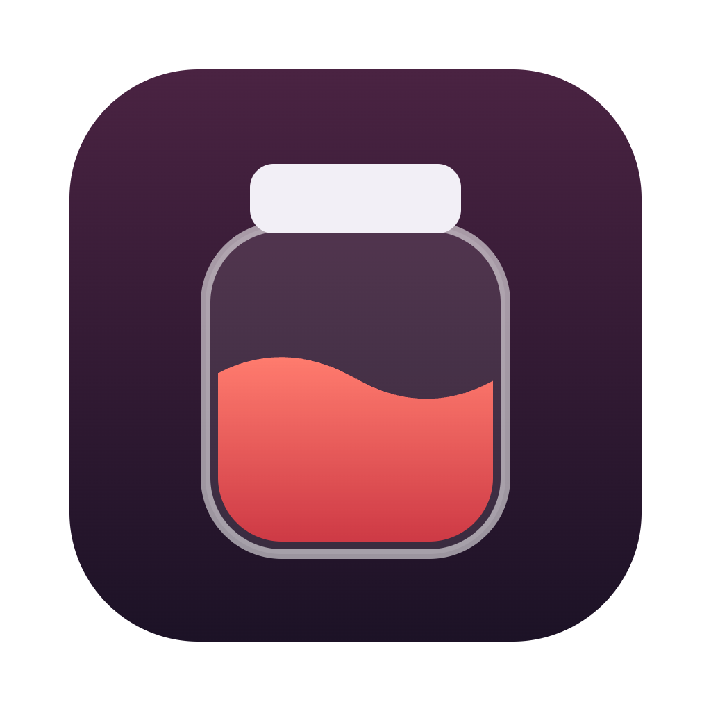
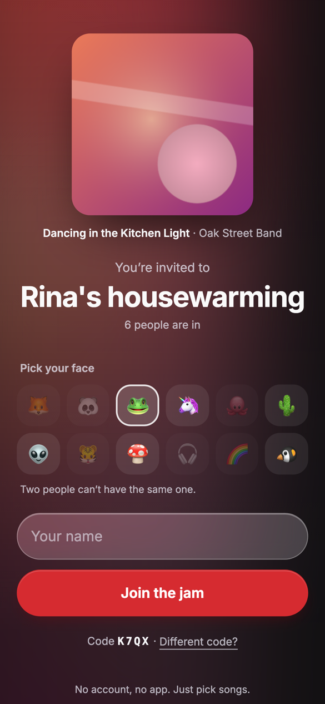
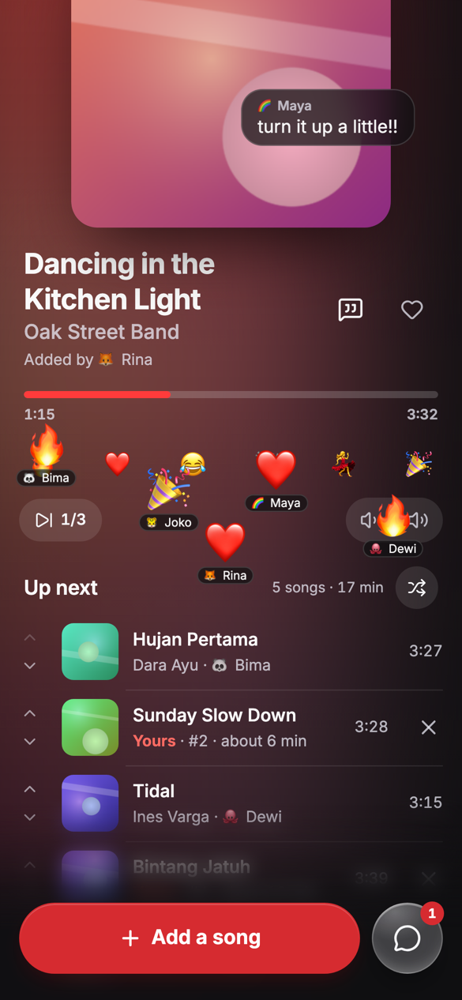
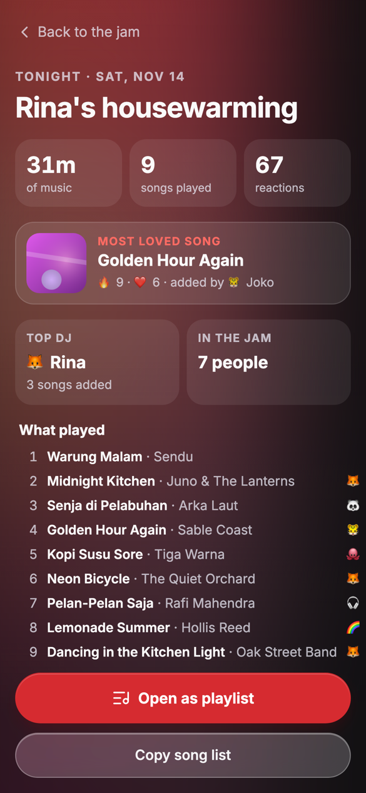
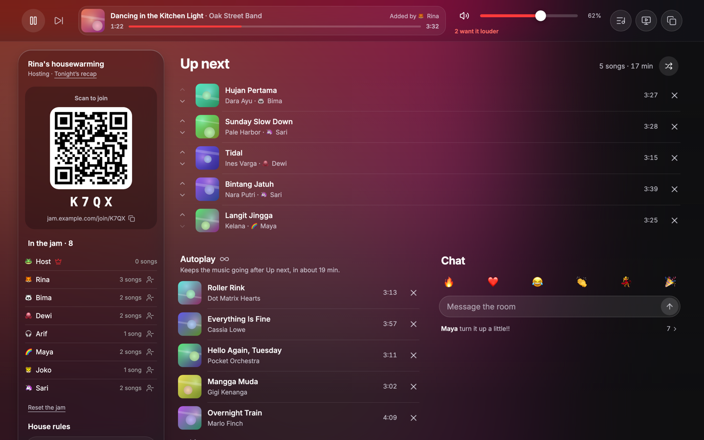
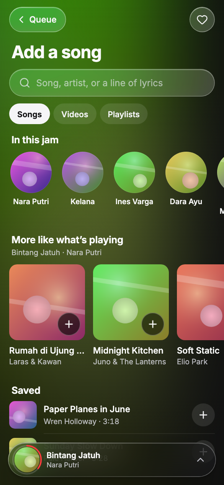
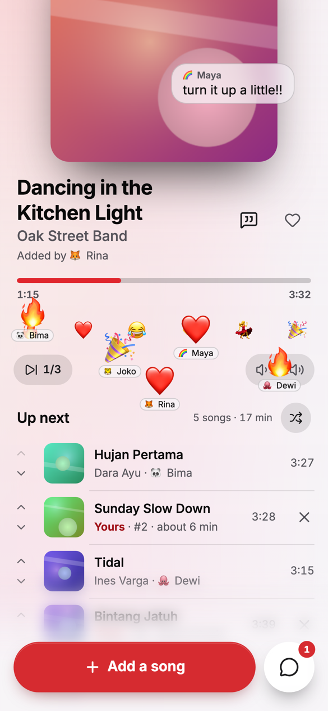
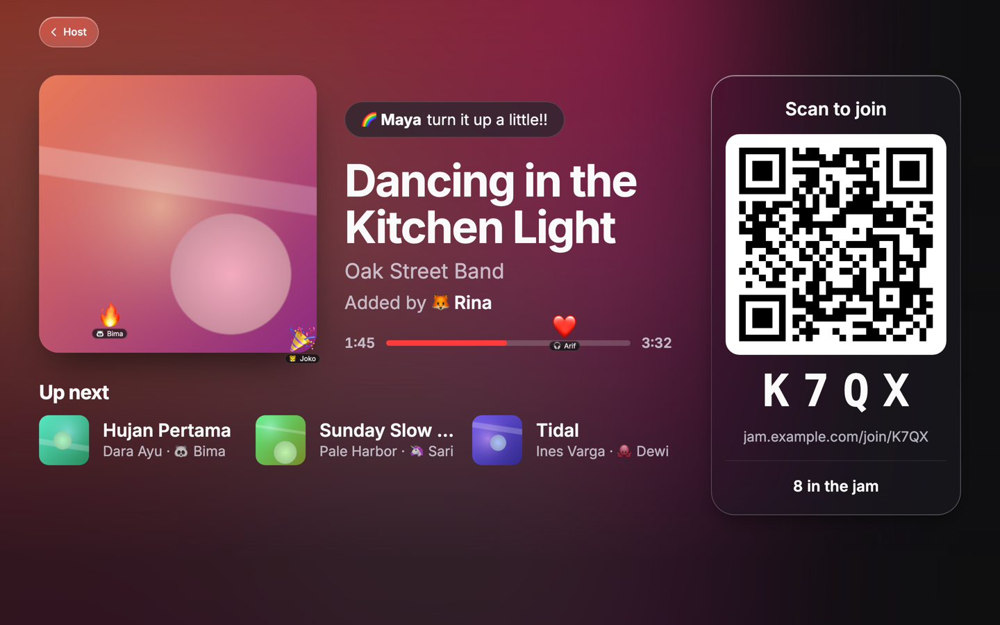

<p align="center">
  
</p>

<h1 align="center">Nimbrung</h1>

<p align="center">
  A self-hosted jam for YouTube Music.<br>
  One laptop plays through the speaker. Everyone else adds songs from their phone.<br>
  No account, no app.<br>
  <sub>A hobby project, made for fun.</sub>
</p>

<p align="center">
  <i>nimbrung</i> (Indonesian): to join in on something already going.
</p>

<p align="center">
  <a href="https://nimbrung.dezeto.dev">nimbrung.dezeto.dev</a> ·
  <a href="https://github.com/dezeto/nimbrung/releases/latest/download/Nimbrung.zip">Download for macOS</a>
</p>

<p align="center">
  
  &nbsp;
  
  &nbsp;
  
</p>

<p align="center">
  
</p>

## How it works

1. **The host plays.** A laptop plugged into the speaker runs the YouTube
   Music desktop app and Nimbrung.
2. **Guests scan the QR code.** It's on the host page, or on a TV showing the
   room view. They type a nickname, pick a face and they're in.
3. **Everyone adds songs.** Picks play in the order they were added, ahead of
   autoplay. When Up next runs out, autoplay keeps the music going.

## What guests can do

- **Join with a name and a face.** Pick one of twelve emoji faces; the ones
  already taken are greyed out. The face shows next to every song you add.
- **Search** songs, videos or playlists (pick songs from one), even by a line
  from the lyrics, and add them. Before anyone types, Add a song already
  shows the artists in this jam, songs like the one playing and their saved
  songs. Type an artist's name and they come first: tap them for all their
  songs, most played first.
- **Share a link** from the YouTube Music app (Share → Nimbrung) or paste one.
  A playlist link opens the playlist to pick songs from, so guests can bring
  their own (public or unlisted; private ones can't be read).
- **Save songs** with the heart, on what's playing or in search. The list
  stays on their phone for the next jam, under ♡ at the top of Add a song.
- **Reorder** Up next with ↑/↓ (or drag with a mouse), remove their own songs,
  or **shuffle** Up next. Everyone sees who shuffled, and every song keeps who
  added it.
- **Vote to skip**: the song skips when enough guests vote.
- **Ask for louder or quieter**: guests can't touch the volume, but the host
  sees "2 want it louder" next to the volume slider.
- **React and chat**: emoji float over the song on every screen, and one-line
  comments slide by. Song activity ("Rina added …") shows quietly too.
- **Read the lyrics** of the song playing. When [LRCLIB](https://lrclib.net)
  has timed lyrics, the lines follow the song.
- **See the recap** of the night (the sparkle at the top of the queue, or
  `/recap`): time of music, songs played,
  reactions, the most loved song, the top DJ and the full list, which opens
  as a YouTube playlist or copies as text.

<p align="center">
  
  &nbsp;
  
</p>

The page follows the phone: dark for dim rooms, light for bright ones.

## What the host can do

At `/host`:

- Play/pause, skip, volume and mute.
- Reorder Up next, remove any song, and take songs out of Autoplay before
  they play.
- Remove a guest, or block their network from joining again.
- House rules: adds per minute, votes to skip (0 = only you can skip), and
  ask to join (new guests wait until you let them in).
- React and chat with the room.
- The QR code and the join link, with buttons to copy the invite and to open
  the room view or the guest queue.
- **Reset the jam** for the next party: removes everyone and clears Up next.

At `/room`, the room view for a TV: big artwork, the song playing, the next
three songs, reactions and chat as they happen, and the join QR. When the song
has lyrics, they show there instead, with a switch back to the queue.

<p align="center">
  
</p>

## Download (macOS)

[**Download Nimbrung.zip**](https://github.com/dezeto/nimbrung/releases/latest/download/Nimbrung.zip)
(macOS 14 or later, Apple Silicon or Intel). Nothing to build: the app carries
the server inside. You need [Homebrew](https://brew.sh) and a YouTube Music
account; the setup window installs the YouTube Music desktop app
([pear-desktop](https://github.com/pear-devs/pear-desktop)) for you. It isn't notarised by Apple yet, so the first open takes one
extra step; see [Send the app to a friend](#send-the-app-to-a-friend), steps 1–4.

## Quick start on macOS

You need macOS 14 or later, [Homebrew](https://brew.sh), Xcode's command line
tools (for `swiftc`), Go 1.24+ and Node.js with npm.

```sh
git clone https://github.com/dezeto/nimbrung.git && cd nimbrung
cd web && npm install && cd ..    # first time only
make build && make app
```

If `swiftc` stops with "plugin for module 'SwiftUIMacros' not found", your
Command Line Tools have a newer SDK than their Swift can build SwiftUI with
(no Xcode installed). Build against the older SDK they also ship:
`SDKROOT=/Library/Developer/CommandLineTools/SDKs/MacOSX26.5.sdk make app`
(the same for `make dist`).

This builds `./nimbrung` and puts **Nimbrung** in `/Applications`. Open it: a
jar shows up in the menu bar, and the first time a setup window opens (later,
**Set up…** in the menu). It walks through six steps and runs the real commands
for you:

1. **Welcome.**
2. **YouTube Music**: installs the app with Homebrew if it's missing, and asks
   you to sign in.
3. **Player control**: turns on the app's API Server, then asks you to click
   **Allow** in YouTube Music so Nimbrung can control the player.
4. **Sharing**: how guests reach you. **Wi-Fi** (same network, nothing to set
   up), **ngrok** (a free link) or **your own domain** on Cloudflare (a named
   tunnel).
5. **Your jam**: the room name and a join code like `K7QX`.
6. **Test run**: starts a jam and shows the QR once it's live.

It saves your answers to `~/.config/nimbrung/jam.env`. From then on, click the
jar and **Start the jam**.

The app runs `./nimbrung` and `scripts/jam.sh` from this folder, so keep the
folder where it is (or run `make app` again after moving it).

## Send the app to a friend

```sh
make dist    # → dist/Nimbrung.zip (about 8 MB, Apple Silicon and Intel)
```

`dist/Nimbrung.app` carries the server and `scripts/jam.sh` inside it, so your
friend needs no copy of this repo, no Go and no Node. Send them
`dist/Nimbrung.zip`. Their Mac needs macOS 14 or later, [Homebrew](https://brew.sh)
(it also installs Apple's command line tools, which give `jam.sh` its
`python3`), and a YouTube Music account; the setup window installs the
YouTube Music app, and ngrok or cloudflared if they share beyond their Wi-Fi.

What your friend does:

1. Double-click the zip, then drag **Nimbrung** into **Applications**.
2. Open it once. The app is signed by you, not by an Apple developer ID, so
   macOS refuses it the first time with a warning. Close the warning; don't
   move the app to the Trash.
3. Open **System Settings → Privacy & Security**, scroll down, click
   **Open Anyway** next to Nimbrung, then **Open** when macOS asks again.
   This is needed once. (On macOS 14, Control-click the app and choose
   **Open** also works; macOS 15 removed that.) Or, in Terminal:
   `xattr -dr com.apple.quarantine /Applications/Nimbrung.app`
4. A jar shows up in the menu bar and the setup window opens: the same six
   steps as above.

## Manual setup (any system)

### Requirements

- macOS, Windows or Linux laptop connected to the speaker
- [YouTube Music desktop app](https://github.com/pear-devs/pear-desktop/releases)
  (pear-desktop, formerly th-ch/youtube-music), logged in
- Go 1.24+ and Node.js with npm, only to build (it's built with Node 24)

### Set up the YouTube Music app (once)

1. Install it from the releases page above. On a Mac,
   `brew install --cask pear-devs/pear/pear-desktop` installs it as
   "YouTube Music.app" and clears the download quarantine for you. If you
   download it yourself and macOS says the app is damaged:
   `xattr -cr "/Applications/YouTube Music.app"`.
2. In the menu bar: **Plugins → API Server [Beta] → Enabled**.
3. In the same submenu keep the port at **26538**, set the hostname to
   **127.0.0.1** (so only this laptop can control the player), and leave
   authorization on **"approve at first"**.

### Run it

```sh
cd web && npm install && cd ..    # first time only
make build                        # → ./nimbrung, one binary with the UI inside
./nimbrung -name "my living room"
```

The first run asks YouTube Music for access: click **Allow** in the app. The
token is cached, so later runs are silent. Then the terminal prints:

```
Nimbrung is up.
  Guests:  http://192.168.1.20:8080/join/K7QX
  Host:    http://localhost:8080/host?key=3f9c2a1b7e4d8a60
  Code:    K7QX
```

Open the **Host** link on the laptop and let guests scan the QR code there.
The code and host key change on every start; keep them with
`-code ABCD -host-key yoursecret`.

| Flag           | Default                  | What it does                                   |
|----------------|--------------------------|------------------------------------------------|
| `-name`        | `the jam`                | Room name shown to guests                      |
| `-listen`      | `:8080`                  | Address for the guest UI and API               |
| `-code`        | random 4 characters      | Join code                                      |
| `-host-key`    | random                   | Secret in the Host link                        |
| `-public-url`  | this laptop's Wi-Fi address | Address guests join on from anywhere, like `https://jam.example.com` (goes in the QR) |
| `-max-adds`    | `3`                      | Songs per guest per minute (`0` = no limit)    |
| `-skip-votes`  | `3`                      | Votes needed to skip                           |
| `-ask-to-join` | `false`                  | New guests wait until the host lets them in    |
| `-state-file`  | `nimbrung/jam.json` in your config folder (`~/Library/Application Support` on a Mac) | Saves the jam so a restart keeps it (`""` = off). See Known quirks |
| `-lyrics`      | `https://lrclib.net`     | Where to look up lyrics (`""` = no lyrics)     |
| `-ytm`         | `http://127.0.0.1:26538` | Where the API Server plugin listens            |

`./nimbrung -h` lists every flag.

### Friends outside the house

The Guests link only works on the same Wi-Fi. For anyone else, open a tunnel
and share the URL it prints:

```sh
ngrok http 8080
```

Don't use a Cloudflare quick tunnel (`cloudflared tunnel --url …`): it doesn't
pass the live updates through (server-sent events), so the queue and
reactions freeze. Guests on your Tailscale tailnet can skip the tunnel and use
`http://<laptop's tailnet name>:8080/join/<code>`.

Anyone with that URL can join, so share it only with your guests, and stop
the tunnel (Ctrl-C) when the party's over. Opening `/host` through the tunnel
URL makes the QR code show the tunnel address too.

### The launcher by hand (macOS)

The setup window does all of this for you. To do it yourself:

With your own domain on Cloudflare, a *named* tunnel gives a fixed address
(unlike the quick tunnel, it passes live updates). Set it up once:

```sh
cloudflared tunnel login                        # pick your domain in the browser
cloudflared tunnel create nimbrung
cloudflared tunnel route dns nimbrung jam.example.com
```

Put your settings in `~/.config/nimbrung/jam.env` (keep it private, it holds
the host key):

```sh
NAME="my living room"
CODE=K7QX
HOST_KEY=some-long-secret
TUNNEL=nimbrung
PUBLIC_URL=https://jam.example.com
```

With ngrok instead (a free static domain from the ngrok dashboard, after
`ngrok config add-authtoken`), set `TUNNEL=ngrok` and
`PUBLIC_URL=https://your-name.ngrok-free.app`. Leave `TUNNEL` and `PUBLIC_URL`
out for Wi-Fi only.

Then `make build && make app` puts **Nimbrung** in `/Applications`: a jar in
the menu bar. **Start the jam** starts YouTube Music (switching its API Server
back on if it got turned off), the tunnel and Nimbrung, ticks each step off,
and opens the host page once guests can reach it. The panel also copies the
invite link (even before you start), opens the host page and the room view
for a TV (⌥R), and stops the jam, asking first if anyone is in it. **Start on
Wi-Fi only** skips the tunnel (no cloudflared needed): the QR shows this Mac's
Wi-Fi link, so only guests on the same network can join. Without the app:
`scripts/jam.sh` (or `scripts/jam.sh --local` for Wi-Fi only), which passes
extra flags on to Nimbrung (`scripts/jam.sh -ask-to-join`).

## Keyboard shortcuts (laptop)

Hold **Option/Alt** to see which letter each button uses (⌥P play/pause,
⌥S skip, ⌥M mute, ⌥A add a song, ⌥Q queue, ⌥C copy invite link). `/` jumps to the
search box, `Esc` goes back, and `?` lists everything.

## Develop

```sh
make dev     # Go API on :8080 + Vite on :3001 with hot reload (use :3001 links)
make test    # Go tests
make lint    # gofmt, go vet, web type check
```

## Known quirks

- **A restart keeps the jam only with the same join code.** The state file
  keeps who's in (so nobody has to join again), who added what (so Up next
  comes back), removed guests, blocked networks and what played (for the
  recap). It doesn't keep chat, skip votes, louder/quieter asks or guests
  still waiting to be let in. Start with a different code (the default is a
  random one) and the jam starts fresh. The YouTube Music queue itself is
  kept by the app.
- **YouTube Music sometimes drops an add.** On some queues the app silently
  ignores "add to the end". Nimbrung adds after the current song instead and
  moves it into place, and tells the guest if the app still didn't take it.

## Who can see and do what

- **Joining needs the code.** It's in the QR and the join link, so share
  those only with your guests. Ten wrong codes from one network lock that
  network out for ten minutes. For a link that travels far, turn on **ask to
  join**, or start with a longer code (`-code`).
- **What's playing isn't secret.** Anyone who has the address, even without
  the code, can see the room name, the song, Up next, nicknames and chat.
  That's what lets a TV show the room view without joining.
- **The Host link is a password.** Anyone with its `?key=` gets host powers.
  The launcher opens it on `localhost`, so the key never goes through the
  tunnel; don't paste it anywhere.
- **What leaves the laptop:** searches and playback go through YouTube Music;
  artist pages, playlists and search suggestions are asked of YouTube Music
  directly, without the host's login;
  the title and artist of each song go to LRCLIB for lyrics (`-lyrics ""`
  turns that off), and the page loads its font from Google Fonts. No
  accounts, no analytics.
- **What stays on it:** nicknames, who added what, and the address each guest
  joined from (for blocking), in the state file. Chat is never saved.

## Thanks

Nimbrung stands on [pear-desktop](https://github.com/pear-devs/pear-desktop),
the open-source YouTube Music desktop app by the pear-devs team (formerly
th-ch/youtube-music). Its API Server plugin is what lets guests reach the
player: without it there would be no jam. Thank you to everyone who builds and
looks after it.

Song lyrics come from [LRCLIB](https://lrclib.net), a free lyrics database run
by its community.

## Licence

[MIT](LICENSE).

## Not affiliated

Nimbrung isn't made by or affiliated with YouTube or Google. It drives the
third-party [pear-desktop](https://github.com/pear-devs/pear-desktop) app
through its API Server plugin.
